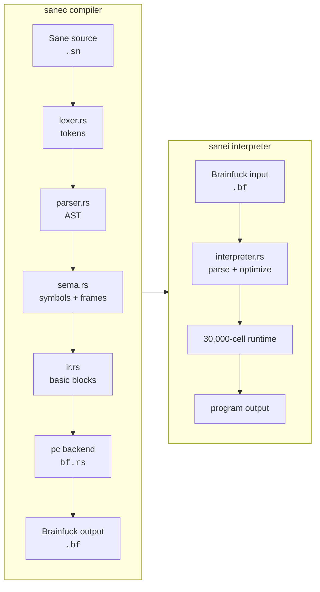

# Architecture

Sane is split into a compiler library, two command-line binaries, and an
optimized Brainfuck runtime.

## Pipeline



## Compiler Stages

1. `lexer.rs` converts source text into tokens and validates literals.
2. `parser.rs` builds the syntax tree for declarations, expressions, and control flow.
3. `sema.rs` resolves scopes and functions, validates symbols and call graphs,
   and assigns tape cells.
4. `ir.rs` splits every program into basic blocks terminated
   by jumps, branches, calls, returns, or halt.
5. The PC code generator in `bf.rs` emits a dispatcher loop around those
   blocks.
6. The final Brainfuck pass removes redundant adjacent clear loops.

Diagnostics retain source spans through parsing and semantic analysis so errors
can point back to the original line and column.

## Tape Layout

The PC backend uses this static tape layout. `control_base` is
`scratch_base + 12`:

```text
cell 0..7                  compiler temporaries
cell 8..scratch_base-1     globals, arrays, static function frames, spills
cell scratch_base..+11     primitive scratch cells
cell control_base+0        block matched flag
cell control_base+1        expected block id
cell control_base+2        dispatch pc copy
cell control_base+3        current block pc
cell control_base+4        running flag if no calls; otherwise call depth
cell control_base+5..      return value (one or four cells, if calls are reachable)
next cell                  running flag (if calls are reachable)
following 16 cells         return-pc stack (if calls are reachable)
remaining cells            control-flow and arithmetic scratch cells
```

### Temporaries

Cells `0..7` are short-lived expression temporaries. Arithmetic and copy
microcode may overwrite them.

### Source Storage

Byte scalars occupy one cell. Int and Q16.16 fixed scalars occupy four
consecutive little-endian cells. Lexical-scope cells return to a free-list
after the scope ends, allowing later non-overlapping variables to reuse
storage.

Function parameters and locals occupy static frame cells. Expression calls use
spill cells when a later call would overwrite an earlier result in `rv`.

Byte arrays occupy four metadata cells followed by their data:

```text
base + 0     space
base + 1     index1
base + 2     index2
base + 3     data transfer cell
base + 4..   array elements
```

Constant array accesses compile directly to a known data cell. Dynamic byte
accesses use the metadata cells and array traversal microcode. Int and fixed
arrays use four cells per element and a 16-cell prefix for strided dynamic
accesses.

### Scratch And Control Cells

The 12 primitive scratch cells support comparisons, integer and fixed-point
arithmetic, bitwise operations, shifts, and decimal printing. Control cells are
allocated in a stack-like manner while emitting branches and expressions.

## Control Flow Lowering

Brainfuck has loops but no jumps. All Sane control flow is lowered to basic
blocks: branches choose successor block ids, loops jump back to a condition
block, and `break` and `continue` jump to the appropriate exit or recheck
block. The PC dispatcher executes those transitions.

## PC Dispatch And Calls

The PC backend wraps the generated program in a dispatcher loop. Each basic
block compares its id with the current `pc`; the matching block performs its
operations and writes the next block id. A halt terminator clears `running` and
ends the dispatcher.

Before code generation, unconditional jump chains are grouped when every
target has one predecessor and is not the program entry or a function entry.
The dispatcher compares only the resulting group heads, and a match executes
the complete group before returning to dispatch.

A call copies arguments into the callee's static frame, pushes the continuation
block id onto the 16-cell return-pc stack, and switches `pc` to the function's
entry block. A return writes its value to `rv`, pops the continuation, and
resumes dispatch there. Semantic analysis rejects recursive call graphs because
static frames cannot represent simultaneous activations of the same function.

## Interpreter Runtime

The normal interpreter parses Brainfuck into higher-level operations before
execution. The debugger intentionally uses raw instructions so breakpoints and
single stepping correspond directly to Brainfuck program counters.

Symbol comments produced by `sanec -s` are ignored during execution but parsed
by the debugger for tape inspection.
