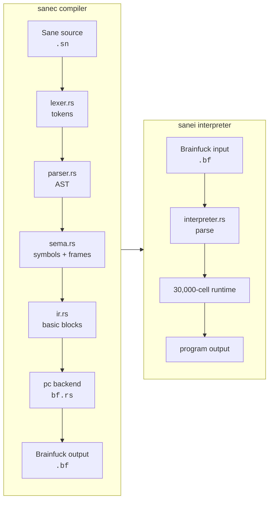

# Architecture

Sane is split into a compiler library, two command-line binaries, and a
Brainfuck runtime.

## Pipeline



## Compiler Stages

1. `lexer.rs` converts source text into tokens and validates literals.
2. `parser.rs` builds the syntax tree for declarations, expressions, and control flow.
3. `sema.rs` resolves scopes and functions, validates symbols and call graphs,
   and assigns tape cells.
4. `ir.rs` splits every program into basic blocks terminated
   by jumps, branches, calls, returns, or halt.
5. The PC code generator in `bf.rs` emits a dispatcher loop around those
   blocks.
6. The final Brainfuck pass removes redundant adjacent clear loops. Unless
   `sanec -c off` is selected, it then writes runs of three or more `+`, `-`,
   `<`, or `>` with a decimal repeat count understood by `sanei`.

Diagnostics retain source spans through parsing and semantic analysis so errors
can point back to the original line and column.

## Tape Layout

The PC backend uses this static tape layout. `control_base` is
`scratch_base + 12`:

```text
cell 0..7                  compiler temporaries
cell 8..scratch_base-1     globals, arrays, static function frames, spills
cell scratch_base..+11     primitive scratch cells
cell control_base+0        block matched flag
cell control_base+1        expected block id
cell control_base+2        dispatch pc copy
cell control_base+3        current block pc
cell control_base+4        running flag
cell control_base+5..      return value (one or four cells)
following cell             call depth
following 16 cells         return-pc stack
remaining cells            control-flow and arithmetic scratch cells
```

### Temporaries

Cells `0..7` are short-lived expression temporaries. Arithmetic and copy
microcode may overwrite them.

### Source Storage

Byte scalars occupy one cell. Int and Q16.16 fixed scalars occupy four
consecutive little-endian cells. Every declaration allocates fresh storage; the
baseline does not reuse cells from earlier lexical scopes.

Function parameters and locals occupy static frame cells. Expression calls use
spill cells when a later call would overwrite an earlier result in `rv`.

Array lengths are capped at 4096 elements. Arrays longer than 256 elements
are split into 256-element pages. Every page starts with a one-cell `P2`
return index, followed by its metadata and data. Byte pages use:

```text
page + 0     P2, return page count
page + 1     space
page + 2     index1
page + 3     index2
page + 4     data transfer cell
page + 5..   up to 256 byte elements
```

Int and fixed pages use 16 metadata cells after `P2`, arranged as four lanes
of (`space`, `index1`, `index2`, `transfer`), followed by four-cell elements.
The `P2` prefix keeps the primitive body's data offsets unchanged: data is
still at `space + 4` for bytes and `space + 16` for int/fixed.

A paged access shares one primitive body across all pages. Array storage is
cleared once at its declaration, and every paged access returns all metadata
cells to zero, so the setup never clears pages. It only seeds page 0:
`space` and `P2` become the page number, `index1`/`index2` become the in-page
offset, and `transfer` receives the value for a set or input store.

The forward loop carries `P2`, `index1`, `index2`, and the `space` count one
page at a time and decrements `space`; when it reaches zero the BF pointer is
at the selected page and the body runs there. Writes also carry the transfer
lanes forward. A backward loop then moves `P2` and the result transfer cell
one page left per iteration and decrements `P2`; it stops at page 0. Byte gets
carry one transfer lane; int/fixed gets carry four. Sets and input stores do
not need a result on the way back.

This keeps the generated primitive body at one copy per access site instead
of one copy per page. Single-page arrays use the same invariant: their
metadata is cleared once at declaration, and a direct get or set only seeds
`index1`/`index2` and the transfer cell, so it does not clear metadata on
every access.

Constant array accesses still compile directly to a known element cell.
Dynamic int indexes split into `page = index >> 8` and `offset = index & 255`;
byte indexes address page 0 only. Two-dimensional declarations of the form
`T[rows][cols]` are flattened to a `rows * cols` array; `cols` may be 1 through
256. `a[i][j]` becomes the flat index `i * cols + j`, so the page walk selects
the containing page and the body sees the low byte as the in-page offset.
Nested row initializers are flattened row-major into the same flat initializer
vector used by one-dimensional arrays. The total element count is capped at
4096. Static storage is capped at 29,000 cells so the
runtime control cells still fit in the 30,000-cell tape.

### Scratch And Control Cells

The 12 primitive scratch cells support comparisons, integer and fixed-point
arithmetic, bitwise operations, shifts, and decimal printing. Control cells are
allocated in a stack-like manner while emitting branches and expressions.

## Control Flow Lowering

Brainfuck has loops but no jumps. All Sane control flow is lowered to basic
blocks: branches choose successor block ids, loops jump back to a condition
block, and `break` and `continue` jump to the appropriate exit or recheck
block. The PC dispatcher executes those transitions.

## PC Dispatch And Calls

The PC backend wraps the generated program in a dispatcher loop. Each basic
block compares its id with the current `pc`; the matching block performs its
operations and writes the next block id. A halt terminator clears `running` and
ends the dispatcher.

The dispatcher compares the current `pc` against every block in turn. It does
not form superblocks or skip empty blocks.

A call copies arguments into the callee's static frame, pushes the continuation
block id onto the 16-cell return-pc stack, and switches `pc` to the function's
entry block. A return writes its value to `rv`, pops the continuation, and
resumes dispatch there. Semantic analysis rejects recursive call graphs because
static frames cannot represent simultaneous activations of the same function.

## Interpreter Runtime

The interpreter first builds a nested parse tree, analyzes each loop body, and
then flattens the result into one bytecode stream with absolute jumps. Adjacent
adds and pointer moves become `Block` instructions. Transfer loops such as
`[->++<]` become `AddMul`; move-only loops such as `[>]` become `ScanZero`;
clear loops become `Set(0)`. Remaining loops use `JumpIfZero` and
`JumpIfNonZero`. `Block` and `AddMul` check the minimum and maximum pointer
positions once, including intermediate positions, so pointer-bounds errors are
preserved.

Normal execution does not collect statistics; `run_with_stats` uses a
compile-time flag so benchmark-only counters do not cost the normal path.
Dynamic array accesses still execute the generated Brainfuck traversal
microcode. Symbol comments produced by `sanec -s` are ignored during execution.
